# Teletext 2.0

[](LICENSE)
[](package.json)
[](https://nextjs.org/)
[](https://convex.dev/)
[](https://kiroween.devpost.com/)

> **Publish to the public in two minutes, read in two seconds.**

A modern, ultra-lightweight, offline-first teletext broadcast and interactive card service. Schools, clinics, municipal transit unions, and community groups paste any notice, and AI condenses it into authentic 40x24 teletext pages with a **Fact Guard** that verifies every date, time, phone number, and figure against the source document. Readers simply dial a 3-digit page number to receive instant updates on any phone—even on 2G connections or fully offline.

Built for **Kiroween 2026** under the **Resurrection** category (bringing dead tech back to life) with **Kiro**.

---

## ⚡ Quick Links

| Resource | Link / Instructions |
|---|---|
| **Live Web App** | [teletext-2-0.vercel.app](https://teletext-2-0.vercel.app) |
| **Try the Reader** | Open the live link and dial `4` `1` `2` (or press `R`, `G`, `Y`, `B` for Fastext) |
| **Interactive Lookup** | Try the student results lookup with Student ID `1001` and PIN `1234` |
| **Publisher Dashboard** | Access `/dashboard` (demo credentials provided privately in the Devpost submission) |
| **Demo Video** | Watch the walkthrough on [YouTube](https://youtu.be/iFhvZCp7y1s) |

---

## 📸 Screenshots

<p align="center">
  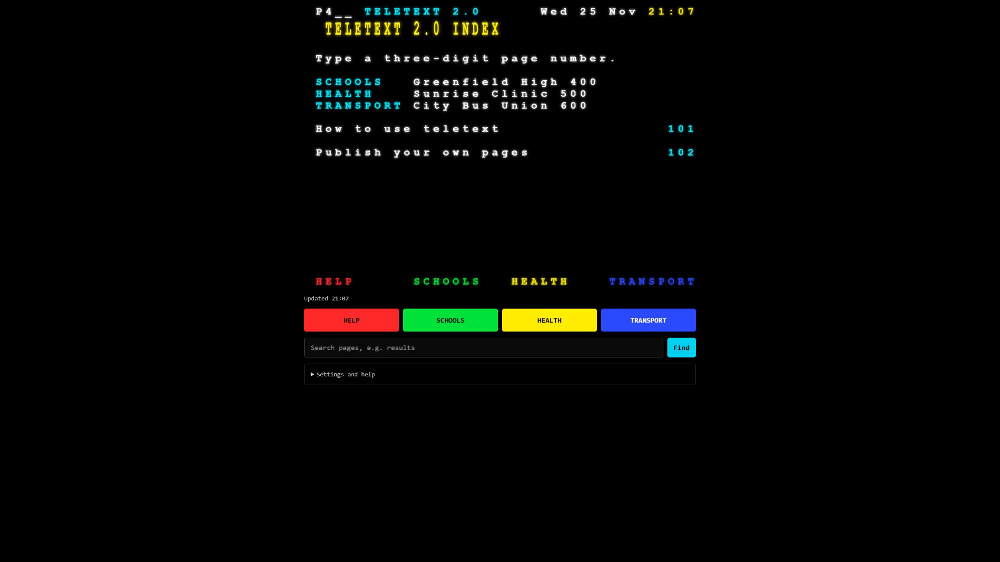
</p>

| Public Reader & Directory | Community Hub |
|:---:|:---:|
| 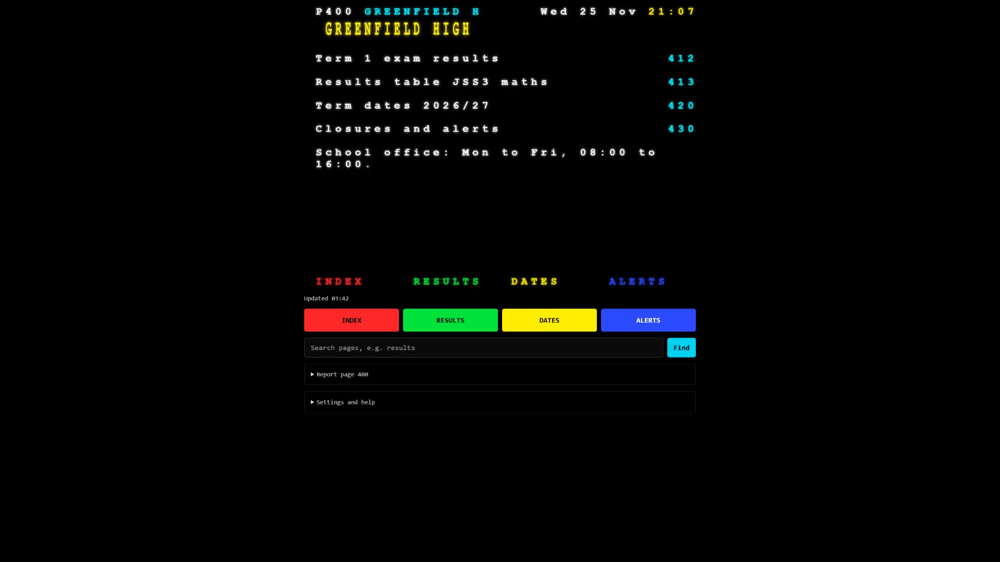 | 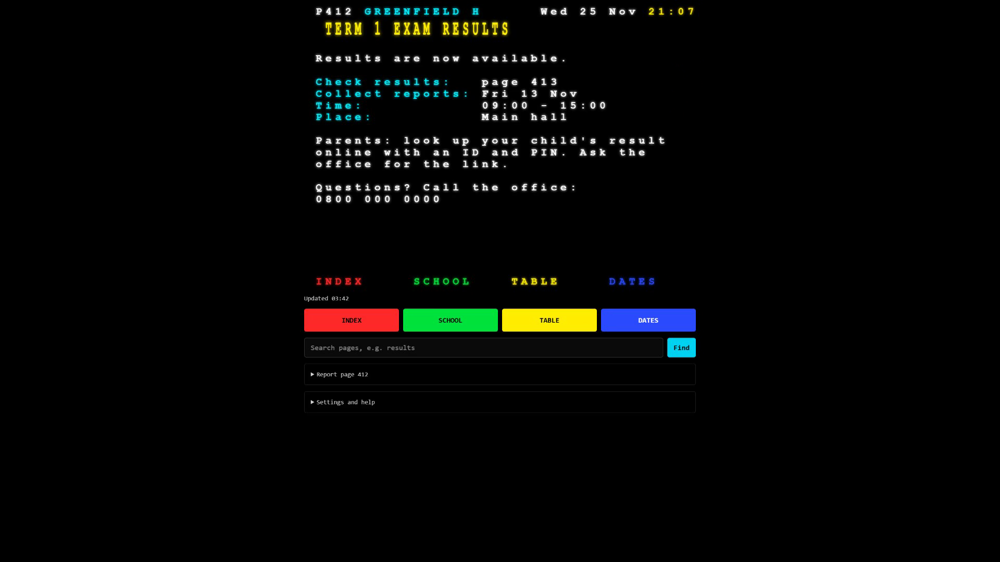 |
| **P400: Greenfield High Channel Hub** | **P412: High-Contrast Notice Page** |

| Interactive Private Lookup | Security & Error Handling |
|:---:|:---:|
| 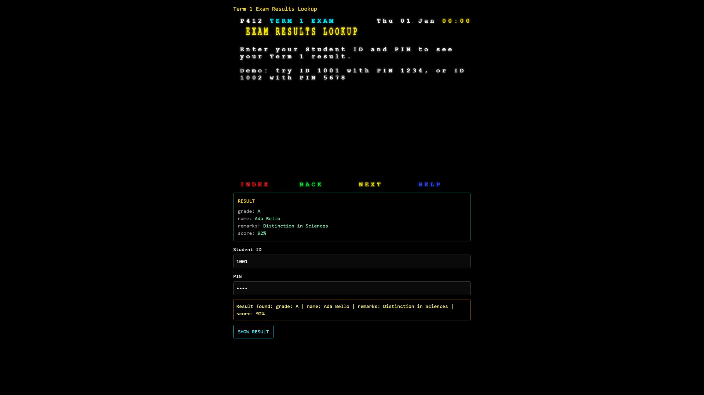 | 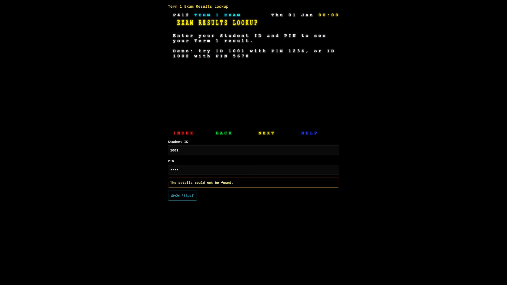 |
| **P410: Student ID & Salted PIN Lookup** | **Instant Error State & Safety Validation** |

| Two-Way Parent Inquiry | CardScript Community Trivia |
|:---:|:---:|
| 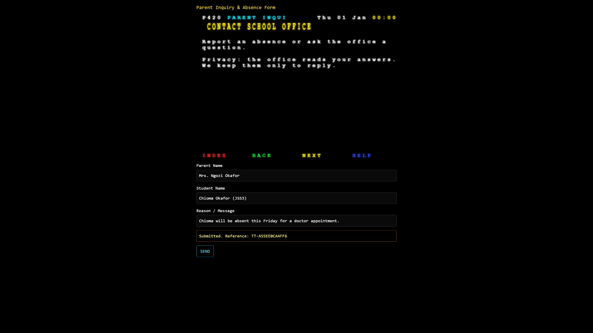 | 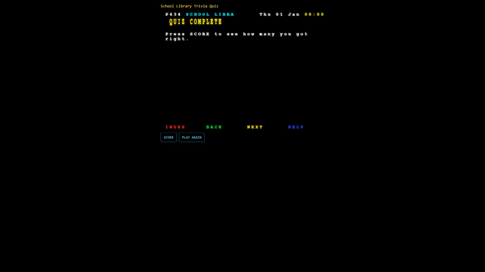 |
| **P420: Absence Form with Trackable Reference** | **P430: Deterministic Quiz Engine** |

| Publisher Admin Dashboard | Live Page Editor & CRT Preview |
|:---:|:---:|
| 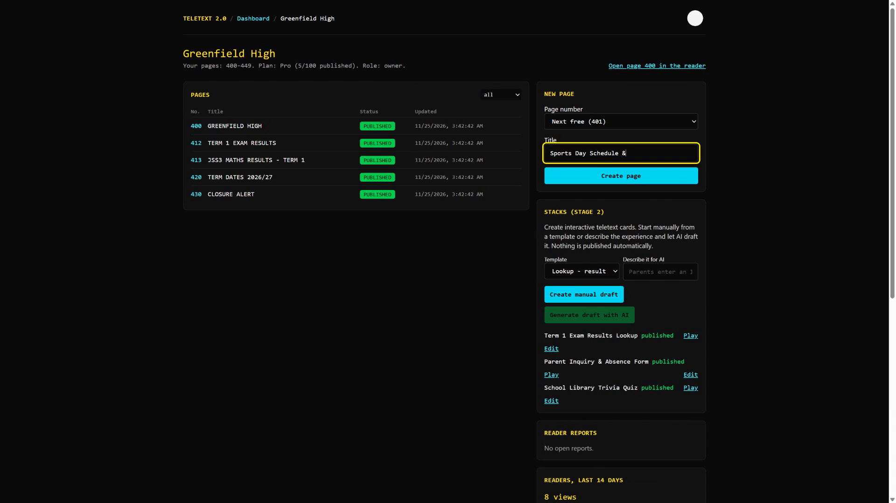 | 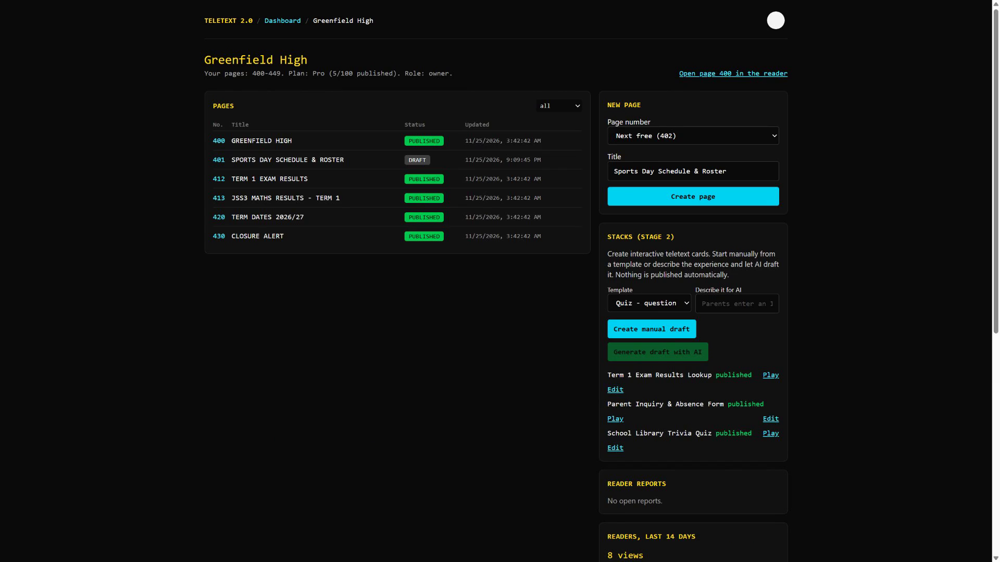 |
| **Organization Management & 14-Day Analytics** | **Dual Split Editor & Live Teletext Preview** |

| Visual & Code Stack Builder | Gemini AI Condenser & Fact Guard |
|:---:|:---:|
| 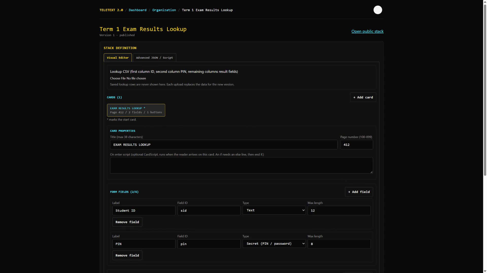 | 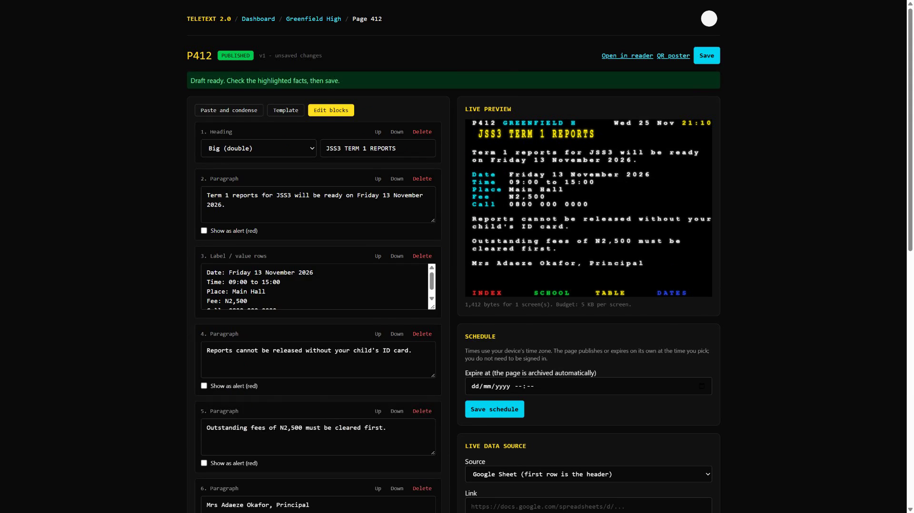 |
| **Interactive Stack Builder (Visual & JSON)** | **AI Condenser with Fact Guard Cross-Verification** |

---

## ✨ Features

### 📺 For Readers (Instant, Free, Zero Login)
- **Authentic 40x24 Grid**: Faithful teletext CRT aesthetic with 8-color palette, double-height headings, and sextant mosaic graphics.
- **Instant Keyboard & Touch Controls**: Dial 3-digit numbers (`100`–`899`), swipe between sub-pages, or jump using red, green, yellow, and blue **Fastext** hotkeys (`R`, `G`, `Y`, `B`).
- **Offline PWA**: Full service worker caching. Visited pages remain accessible offline, marked with an **`OFFLINE COPY`** freshness badge.
- **Inclusive Accessibility**: Plain-text **Clean Mode**, high-contrast palettes, reduced motion support, live screen-reader announcements, and full keyboard-only navigation. Passes WCAG 2 AA with **0 axe violations**.
- **Sub-5 KB Payloads**: Compressed JSON page payloads clock in under 5 KB, loading in milliseconds over edge CDN.

### 📝 For Publishers & Community Admins
- **AI Condenser**: Paste unstructured notices, schedules, or announcements; Google Gemini condenses them into formatted 40x24 teletext pages.
- **The Fact Guard**: Every date, time, monetary amount, telephone number, and name is extracted and cross-referenced with source sentences. Hallucinated numbers are flagged in red and must be confirmed before publishing.
- **Stage 2: Stacks (HyperCard meets Teletext)**:
  - **Secure Lookups**: Publishers upload a CSV (e.g., student grades); PINs are hashed using SHA-256 on save. Readers look up private rows without leaking other records.
  - **Inquiry & Feedback Forms**: Readers submit forms from teletext cards; submissions route directly to a live Publisher Inbox with status tracking.
  - **Quizzes & Decision Trees**: Multi-card interactive workflows powered by **CardScript**, a custom, sandboxed domain-specific language with a strict 200-step execution cap.
  - **Visual + Code Stack Editor**: Visual deck builder with clickable card chips, form field managers, and button action presets alongside an advanced JSON mode.
- **Printable A4 QR Posters**: One-click generation of printable posters with an error-corrected QR code and large teletext page numbers for physical noticeboards.
- **Scheduled Publishing & Expiry**: Schedule pages to publish or archive automatically via background cron triggers. Expired pages fail closed immediately.
- **Live Connectors**: Sync pages automatically from public Google Sheets or RSS/Atom feeds every 15 minutes.
- **Team Roles & Audit Logs**: Owner, Editor, and Viewer permissions managed through one-time 7-day cryptographically hashed invite codes.

---

## 🛠 Tech Stack

- **Frontend**: Next.js 16 (App Router), React 19, Tailwind CSS.
- **Backend & Database**: [Convex](https://convex.dev) (real-time database, mutations, scheduler crons).
- **Authentication**: [Hexclave](https://hexclave.com) (passwordless and secure auth).
- **AI & NLP**: Google Gemini (via `@google/genai`) with extractive fallback baselines and multi-tier model failover.
- **Testing**: Vitest, `@playwright/test` for E2E, and [fast-check](https://fast-check.dev) for property-based testing.
- **Deployment**: Vercel (Edge Network & Functions).

---

## 📂 Repository Architecture

```
Teletext-2.0/
├── .kiro/                 # Kiro specs, steering documents, hooks, and MCP config
│   ├── specs/             # 9 formal specs (requirements, invariants, tasks)
│   ├── steering/          # 7 domain steering rules (tech, security, testing, style)
│   ├── hooks/             # Agent hooks (boundary guard, secret guard, tests on save)
│   └── settings/mcp.json  # Convex MCP configuration
├── apps/
│   └── web/               # Next.js 16 application & Convex backend (convex/)
├── packages/
│   ├── core/              # 100% pure TypeScript: renderer, layout, normalizer, validator
│   ├── stacks/            # Pure CardScript engine: lexer, AST, interpreter, visual deck helpers
│   └── ai/                # Fact guard, Gemini prompt templates, 20-case eval harness
├── tests/
│   └── e2e/               # Playwright browser end-to-end and live tests
└── scripts/               # Boundary guard and pre-submit validation scripts
```

> **Core Purity Guarantee**: `packages/core` contains zero dependencies on the browser, database, network, clock, or randomness. This is continuously verified by `npm run check:boundary`.

---

## 🚀 Getting Started

### Prerequisites
- Node.js 22+
- A free [Convex](https://convex.dev) account
- A [Hexclave](https://app.hexclave.com) project
- A [Google Gemini API Key](https://aistudio.google.com/api-keys)

### Installation

```bash
# Clone the repository
git clone https://github.com/samolubukun/Teletext-2.0.git
cd Teletext-2.0

# Install dependencies
npm install

# Configure environment variables
cd apps/web
cp .env.example .env.local

# Initialize Convex dev deployment
npx convex dev

# Seed demo data (Greenfield High & public pages)
npm run seed --workspace @teletext/web

# Start local development server
cd ../..
npm run dev
```

Open [http://localhost:3000](http://localhost:3000) to view the reader.

---

## 🧪 Testing & Verification

The test suite combines unit tests, Convex integration tests, and randomized **property-based testing (PBT)** up to 10,000 iterations:

```bash
# Run all unit and property-based tests
npm test

# Run heavy property-based testing (10,000 generated cases per property)
FC_RUNS=10000 npm test

# Verify TypeScript types across all 4 workspaces
npm run typecheck

# Verify packages/core purity
npm run check:boundary

# Run pre-submission compliance check
npm run pre-submit

# Run Playwright E2E reader and accessibility tests
npm run e2e
```

---

## 🤖 Built With Kiro

This project was built from ground zero using **Kiro** and its spec-driven methodology:

1. **Spec-Driven Architecture**: 9 specifications created in `.kiro/specs/` before writing code, each defining mathematical correctness properties (e.g., layout invariants P1–P15, scheduling rules S1–S4).
2. **Steering Documents**: 7 persistent steering docs in `.kiro/steering/` enforcing strict Next.js 16 conventions, security boundaries, and retro teletext standards.
3. **Automated Agent Hooks**: Guarded development with 6 hooks (`core-boundary-guard`, `secret-guard`, `spec-sync`, `core-tests`, `style-guard`, `ai-typecheck-tests`).
4. **Property-Based Bug Discovery**: Fast-check fuzzing surfaced subtle bugs that example unit tests missed (e.g., a 150-character heading overflowing subpages, standalone Yoruba tone marks mistaken for emoji, and `NaN` timestamp comparisons).
5. **Model Context Protocol (MCP)**: Integrated Convex MCP (`.kiro/settings/mcp.json`) to inspect live tables and debug schema changes in real time.

See [`docs/kiro-notes.md`](docs/kiro-notes.md) for the development log and prompt iteration benchmarks.

---

## 📄 License

This project is licensed under the **MIT License**. See the [LICENSE](LICENSE) file for details.
